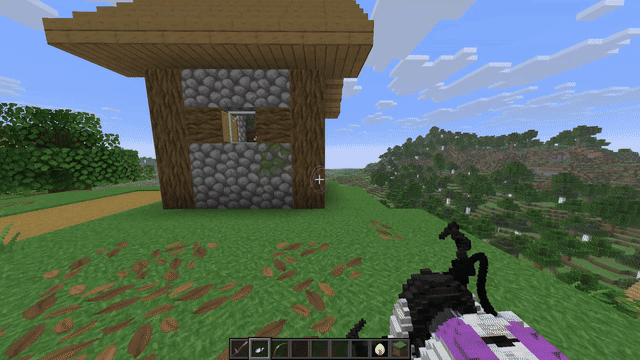
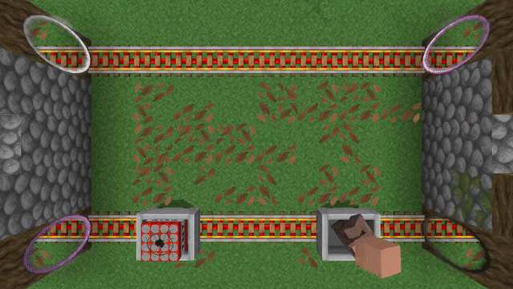
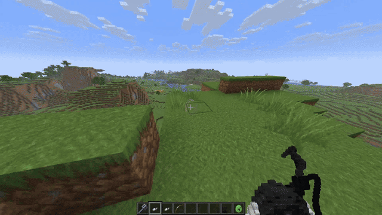

<p align="center">
  <strong>Русский ✓</strong> · <a href="docs/README.en.md">English</a>
</p>

<p align="center">
  
</p>

<h1 align="center">Portalix</h1>

<p align="center">
  Мод, добавляющий портальную пушку в Minecraft.
</p>

<p align="center">
  
  
  
</p>

<p align="center">
  <a href="#установка">Установка</a> · <a href="#управление">Управление</a> · <a href="#сборка">Сборка</a> · <a href="tests/README.md">Тесты</a> · <a href="#планы">Планы</a>
</p>

<p align="center">
  
</p>

---

> [!WARNING]
>
> На компьютерах слабой мощности вероятны падения FPS и/или зависания, особенно в следующих случаях:
>
> - При использовании шейдеров Iris
> - При большом количестве активных порталов в поле зрения


## Совместимость

Portalix изменяет работу многих подсистем Minecraft, поэтому совместимость с модами для оптимизации не гарантируется. Если вы столкнулись с ошибкой или несовместимостью с другим модом, создайте issue в GitHub-репозитории Portalix.

Поддерживаются Sodium **0.9.2** и Iris на OpenGL (**1.11.4** для Minecraft 26.1.2 и 26.2, **1.11.7** для 26.3).

## Установка

Выберите JAR для своей версии Minecraft и загрузчика. [Релизы Portalix](https://github.com/Yan4ik000/Portalix/releases)

| Minecraft | Fabric Loader | Fabric API | NeoForge |
| --- | --- | --- | --- |
| 26.1.2 | 0.19.5+ | 0.155.3+26.1.2 | 26.1.2.129+ |
| 26.2 | 0.19.5+ | 0.161.0+26.2 | 26.2.0.93+ |
| 26.3 | 0.20.1+ | 0.166.2+26.3 | 26.3.0.115+ |

Поместите JAR в папку `mods` на клиенте и сервере. Для Fabric добавьте туда же Fabric API. Версия Portalix на клиенте и сервере должна совпадать.

## Управление

| Клавиша | Действие |
| --- | --- |
| ЛКМ | Создать первый портал / бросить объект |
| ПКМ | Создать второй портал / отпустить объект |
| F | Взять / отпустить объект |
| R | Сбросить порталы |

## Настройки

На Fabric откройте "Моды" → Portalix → "Настроить" через [Mod Menu](https://modrinth.com/mod/modmenu). На NeoForge используйте встроенный список модов. В меню можно выключить прицел Portalix и постоянный шум порталов, а также задать радиус обзора для своих и чужих порталов. Значения от 4 до 64 чанков, по умолчанию 8. Обычная дальность обзора мира настраивается отдельно. Настройки сохраняются в `config/portalix-client.json`.

По умолчанию пушкой могут пользоваться все. Операторы и консоль могут менять политику и белый список.

| Команда | Действие |
| --- | --- |
| `/portalix access mode restricted` | Разрешить использование пушки операторам и игрокам из белого списка |
| `/portalix access mode all` | Разрешить использование пушки всем |
| `/portalix access add <игрок>` | Добавить игрока в белый список |
| `/portalix access remove <имя или UUID>` | Удалить игрока из белого списка |
| `/portalix access list` | Показать белый список |

Правила сохраняются в `portalix-access.json` в папке мира. Проход через открытые порталы доступен всем игрокам.

## Ещё примеры

| Захват и бросок объектов | Поездка через портал |
| --- | --- |
|  |  |

### Веселитесь!

Ключ к порталам у вас в руках. Только вам решать, что с ним делать.

<p align="center">
  
</p>

## Сборка

Нужен JDK 25. Команда `build` собирает мод для обоих загрузчиков. Версия по умолчанию - Minecraft 26.3. На Windows используйте `gradlew.bat`.

```sh
./gradlew build
./gradlew build -PmcVersion=26.2
./gradlew build -PmcVersion=26.1.2
```

JAR лежат в `common/build/libs/`. Для одного загрузчика используйте `:fabric:build` или `:neoforge:build`.

`clean` очищает сборку выбранной версии.

## Планы

- Оптимизировать систему порталов и связанные с ней подсистемы мода
- Упростить код, чтобы облегчить обновления и перенос на другие версии Minecraft
- Улучшить совместимость с другими модами
- Перенос мода на другие версии Minecraft

## Лицензия

Собственный код проекта распространяется по лицензии [PolyForm Perimeter 1.0.1](LICENSE.md).
