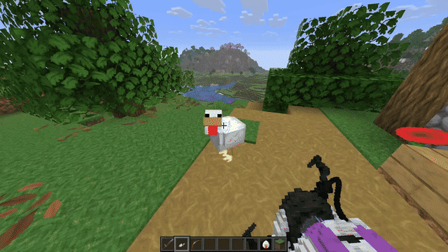

  <strong>Русский ✓</strong> · <a href="docs/README.en.md">English</a>

  

<h1 align="center">Portalix</h1>

  Мод, добавляющий портальную пушку в Minecraft.

  
  
  

  <a href="#установка">Установка</a> · <a href="#управление">Управление</a> · <a href="#сборка">Сборка</a> · <a href="tests/README.md">Тесты</a> · <a href="#планы">Планы</a>

  

---

> [!WARNING]
>
> На компьютерах слабой мощности вероятны падения FPS и/или зависания, особенно в следующих случаях:
>
> - При использовании шейдеров Iris
> - При большом количестве активных порталов в поле зрения

## Совместимость

Portalix изменяет работу многих подсистем Minecraft, поэтому совместимость с модами для оптимизации не гарантируется. Если вы столкнулись с ошибкой или несовместимостью с другим модом, создайте issue в GitHub-репозитории Portalix.

Поддерживаются только Sodium **0.9.2** и Iris **1.11.4** для Minecraft. Используйте версии для своего загрузчика.

## Установка

Выберите сборку Portalix для своего загрузчика и установите обязательные зависимости:

| Загрузчик | Обязательные зависимости для Minecraft |
| --- | --- |
| Fabric Loader 0.19.5+ | Fabric API 0.161.0+26.2 |
| NeoForge 26.2.0.93+ | Не требуются |

Поместите JAR-файл мода и его зависимости в папку `mods` на клиенте и сервере. Версия Portalix на клиенте и сервере должна совпадать.

## Управление

| Клавиша | Действие |
| --- | --- |
| ЛКМ | Создать первый портал / бросить объект |
| ПКМ | Создать второй портал / отпустить объект |
| F | Взять / отпустить объект |
| R | Сбросить порталы |

## Ещё примеры

| Захват и бросок объектов | Поездка через портал |
| --- | --- |
|  |  |

### Веселитесь!

Ключ к порталам у вас в руках. Только вам решать, что с ним делать.

  

## Сборка

Для сборки нужен JDK 25. Gradle использует JDK из `JAVA_HOME` или `PATH`.

Запустите `./gradlew build` на Linux/macOS или `./gradlew.bat build` на Windows. Команда собирает мод для обоих загрузчиков.

Готовые JAR-файлы:

- `fabric/build/libs/Portalix-fabric-<minecraft-version>-<version>.jar`
- `neoforge/build/libs/Portalix-neoforge-<minecraft-version>-<version>.jar`

Чтобы собрать мод только для одного загрузчика, используйте задачу `:fabric:build` или `:neoforge:build`.

## Планы

- Оптимизировать систему порталов и связанные с ней подсистемы мода
- Упростить код, чтобы облегчить обновления и перенос на другие версии Minecraft
- Улучшить совместимость с другими модами
- Перенос мода на другие версии Minecraft

## Лицензия

Собственный код проекта распространяется по лицензии [PolyForm Perimeter 1.0.1](LICENSE.md).
