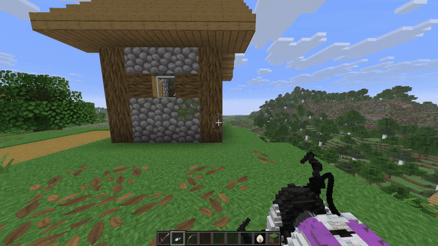
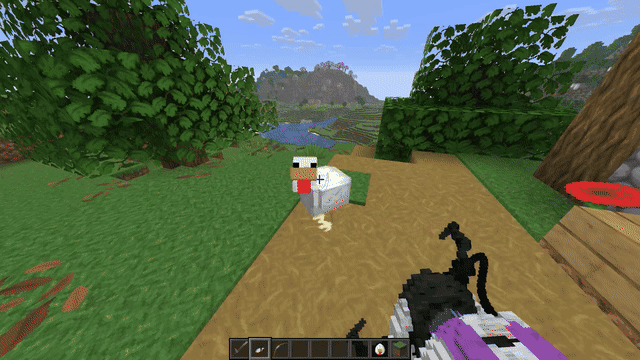
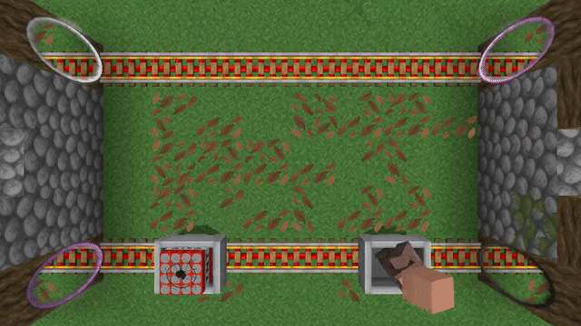
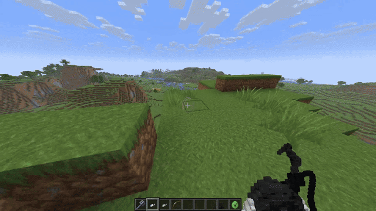

<p align="center">
  <a href="../README.md">Русский</a> · <strong>English ✓</strong>
</p>

<p align="center">
  
</p>

<h1 align="center">Portalix</h1>

<p align="center">
  A mod that adds a portal gun to Minecraft.
</p>

<p align="center">
  
  
  
</p>

<p align="center">
  <a href="#installation">Installation</a> · <a href="#controls">Controls</a> · <a href="#building">Building</a> · <a href="TESTING.en.md">Tests</a> · <a href="#planned-work">Planned work</a>
</p>

<p align="center">
  
</p>

---

> [!WARNING]
>
> FPS drops and/or freezes are likely on lower-end computers, especially in the following situations:
>
> - Using Iris shaders
> - Having many active portals in view, especially at high render distances


## Compatibility

Portalix changes how many Minecraft subsystems work, so compatibility with optimization mods is not guaranteed. If you encounter a bug or an incompatibility with another mod, open an issue in the Portalix GitHub repository.

Supported versions are Sodium **0.9.2** and Iris with OpenGL (**1.11.4** for Minecraft 26.1.2 and 26.2, **1.11.7** for 26.3).

## Installation

Choose the JAR for your Minecraft version and mod loader. [Portalix releases](https://github.com/Yan4ik000/Portalix/releases)

| Minecraft | Fabric Loader | Fabric API | NeoForge |
| --- | --- | --- | --- |
| 26.1.2 | 0.19.5+ | 0.155.3+26.1.2 | 26.1.2.129+ |
| 26.2 | 0.19.5+ | 0.161.0+26.2 | 26.2.0.93+ |
| 26.3 | 0.20.1+ | 0.166.2+26.3 | 26.3.0.115+ |

Put the JAR in `mods` on both the client and server. On Fabric, add Fabric API too. The Portalix version must match on the client and server.

## Controls

| Key | Action |
| --- | --- |
| Left mouse button | Create the first portal / throw object |
| Right mouse button | Create the second portal / release object |
| F | Pick up / release object |
| R | Reset portals |

## Settings

On Fabric, open Mods → Portalix → Configure through [Mod Menu](https://modrinth.com/mod/modmenu). On NeoForge, use the built-in mod list. The screen controls the Portalix crosshair, looping portal sound, and separate view distances for your portals and other players' portals. The range is 4 to 64 chunks and defaults to 8. The normal world view distance is configured separately. Preferences are stored in `config/portalix-client.json`.

By default, every player may use the gun. Operators and the server console can change the policy and allowlist.

| Command | Action |
| --- | --- |
| `/portalix access mode restricted` | Allow operators and allowlisted players to use the gun |
| `/portalix access mode all` | Allow all players to use the gun |
| `/portalix access add <player>` | Add a player to the allowlist |
| `/portalix access remove <name or UUID>` | Remove a player from the allowlist |
| `/portalix access list` | Show the allowlist |

Rules are stored in `portalix-access.json` in the world folder. Every player can pass through open portals.

## More examples

| Grabbing and throwing objects | Riding through a portal |
| --- | --- |
|  |  |

### Have fun!

You hold the key to the portals. What you do with it is up to you.

<p align="center">
  
</p>

## Building

Use JDK 25 and run `gradlew.bat` on Windows. The `build` task covers both loaders and defaults to Minecraft 26.3.

```sh
./gradlew build
./gradlew build -PmcVersion=26.2
./gradlew build -PmcVersion=26.1.2
```

JARs go to `fabric/build/<mc>/libs/` and `neoforge/build/<mc>/libs/`. To build for one loader, use `:fabric:build` or `:neoforge:build`.

`clean` removes the selected version's build output.

## Planned work

- Optimize the portal system and related mod subsystems
- Simplify the code to make updates and ports to other Minecraft versions easier
- Improve compatibility with other mods
- Porting the mod to other Minecraft versions

## License

The project's original code is licensed under [PolyForm Perimeter 1.0.1](../LICENSE.md).
