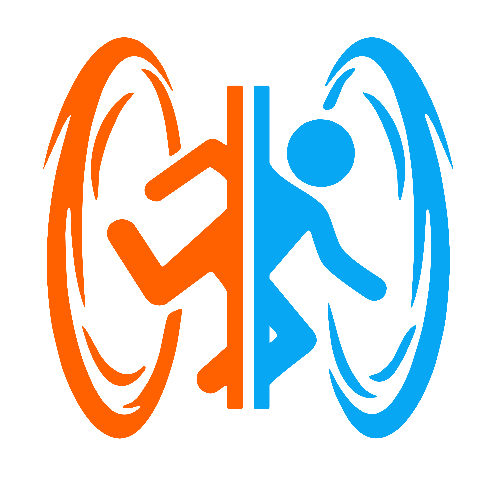
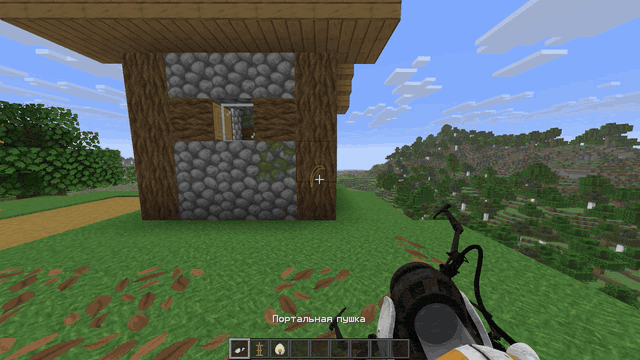
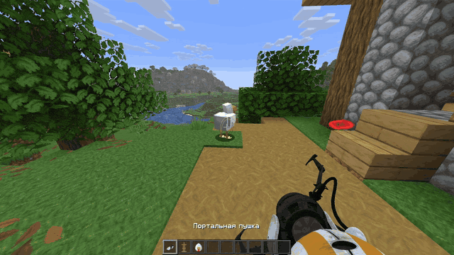
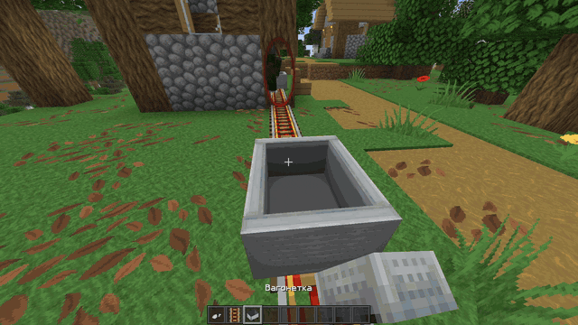
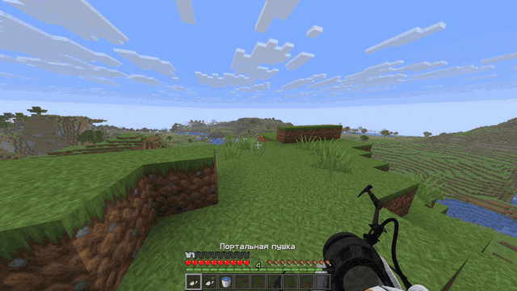

  <a href="../README.md">Русский</a> · <strong>English ✓</strong>

  

<h1 align="center">Portalix</h1>

  A mod that adds a portal gun to Minecraft.

  
  
  

  <a href="#installation">Installation</a> · <a href="#controls">Controls</a> · <a href="#building">Building</a> · <a href="TESTING.en.md">Tests</a> · <a href="#planned-work">Planned work</a>

  

---

> [!WARNING]
>
> The mod is in early access. FPS drops and freezes are likely on mid-range and lower-end computers, especially in the following situations:
>
> - Loading a large number of chunks
> - Placing portals at long distances
> - Having many active portals in view, especially at high render distances
> - Using Iris shaders

## Compatibility

Portalix changes how many Minecraft subsystems work, so compatibility with optimization mods is not guaranteed. If you encounter a bug or an incompatibility with another mod, open an issue in the Portalix GitHub repository.

Only Sodium **0.9.2** and Iris **1.11.4** for Minecraft are supported. Use the versions for your loader.

## Installation

Choose the Portalix build for your loader and install the required dependencies:

| Loader | Required dependencies for Minecraft |
| --- | --- |
| Fabric Loader 0.19.5+ | Fabric API 0.161.0+26.2 |
| NeoForge 26.2.0.93+ | None |

Place the mod JAR and its dependencies in the `mods` folder on both the client and the server. The Portalix version must match on the client and server.

## Controls

| Key | Action |
| --- | --- |
| Left mouse button | Create the first portal / throw object |
| Right mouse button | Create the second portal / release object |
| F | Pick up / release object |
| R | Reset portals |

## More examples

| Grabbing and throwing objects | Riding through a portal |
| --- | --- |
|  |  |

### Have fun!

You hold the key to the portals. What you do with it is up to you.

  

## Building

Building requires JDK 25 and Python 3. Gradle uses the JDK from `JAVA_HOME` or `PATH`.

Run `./gradlew build` on Linux/macOS or `./gradlew.bat build` on Windows. This command builds the mod for both loaders.

Output JARs:

- `fabric/build/libs/Portalix-fabric-<minecraft-version>-<version>.jar`
- `neoforge/build/libs/Portalix-neoforge-<minecraft-version>-<version>.jar`

To build the mod for just one loader, use the `:fabric:build` or `:neoforge:build` task.

## Planned work

- Optimize the portal system and related mod subsystems
- Simplify the code to make updates and ports to other Minecraft versions easier
- Improve compatibility with other mods
- Porting the mod to other Minecraft versions

## License

The project's original code is licensed under [PolyForm Perimeter 1.0.1](../LICENSE). See [NOTICE](../NOTICE) for information about third-party materials and their terms of use.
